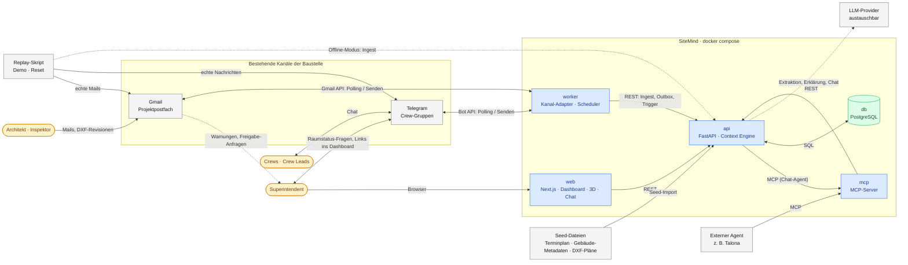
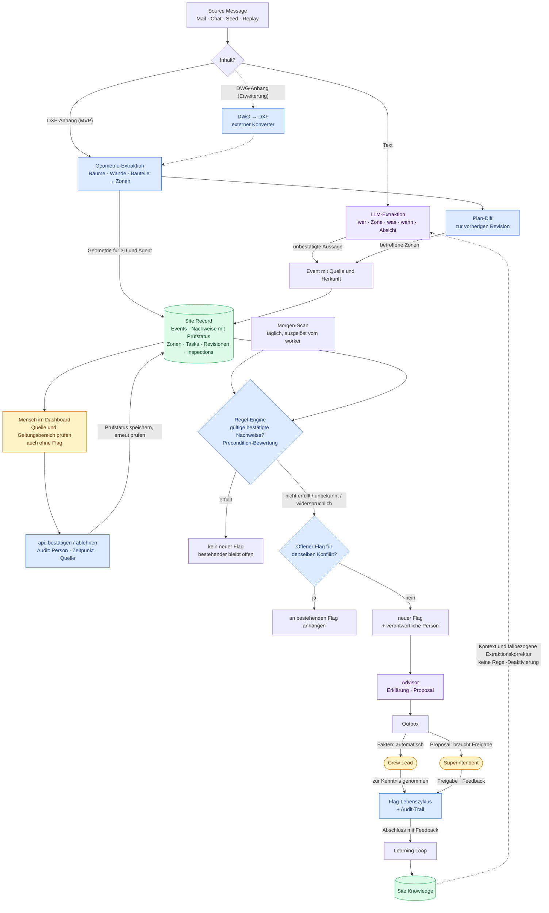
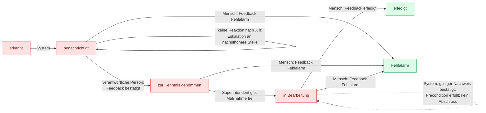

# Puntimata

## Frontend Design-Mockup
[https://claude.ai/artifact/3MjWimC7hjDSDSK9RqtxxN#page-dcb81aee8d83](https://claude.ai/artifact/3MjWimC7hjDSDSK9RqtxxN#page-dcb81aee8d83)

## Lokal starten (Issue #2)

Voraussetzung: Docker mit Compose v2 und laufender Docker Engine (Linux-Container).
Die Basis-Images unterstützen x64 und ARM64; es wird keine Plattform erzwungen.

```sh
cp .env.example .env
docker compose up --build
```

In PowerShell statt `cp`: `Copy-Item .env.example .env`. Beim ersten Start baut auch
`docker compose up` die noch fehlenden Images; nach Codeänderungen `--build` verwenden.

- Dashboard: http://localhost:3000 – zeigt den aktuellen API- und DB-Status.
  Der Next.js-Server fragt dafür die API ab, die mit `SELECT 1` PostgreSQL prüft.
  Zum Aktualisieren die Seite neu laden.
- Statischer Site Record (Issue #5): Nach dem Start in einem zweiten Terminal
  `docker compose exec api python -m app.seed` ausführen. Das Dashboard zeigt dann
  Zonen, Terminplan, Crews, Revisionen/Bestätigungen und Inspections.
  Evidence mit Quelle, genauem Geltungsbereich und Prüf-Historie steht unter
  `/evidence` sowie lesend im Dashboard. Synthetische Ausgangsnachweise sind
  von unbestätigten Aussage-Beispielen getrennt; Seed-Herkunft ersetzt keine
  erfundene menschliche Freigabe. Der explizite Demo-Reset setzt auch diese
  Nachweise samt Historie zurück. Extraktion (#6) und menschliche Prüf-Aktion
  (#9) verwenden den Vertrag in [SITE_RECORD.md](docs/SITE_RECORD.md).
  Derselbe Befehl setzt die statischen Daten auf den Seed-Ausgangszustand zurück.
  Format, Zonen-IDs für #3, REST-Vertrag und Migrationen: [docs/SITE_RECORD.md](docs/SITE_RECORD.md).
- API-Health: http://localhost:8000/health – `200` mit
  `{"api":"ok","db":"ok"}`, bei DB-Ausfall `503` mit `db: "error"`.
- CAD-Geometrie (#15): Nach dem Seed-Import
  `docker compose exec api python -m app.cad_import` ausführen. Importiert alle fünf
  DXFs aus #3 samt Metadaten; Originaldateien bleiben je Revision gespeichert.
  Geometrie in Metern unter `/geometry?floor_id=F3` bzw.
  `/geometry?zone_id=3B&revision_id=A-103-D`. API-/Importvertrag und 3D-Koordinaten:
  [docs/CAD-PIPELINE.md](docs/CAD-PIPELINE.md). Ein Seed-Reset entfernt auch die
  daraus abgeleitete Geometrie; danach den CAD-Import erneut ausführen.
- OpenAPI: http://localhost:8000/openapi.json, interaktive Dokumentation unter `/docs`.
- MCP: http://localhost:8001/mcp – startbarer Streamable-HTTP-Server ohne Tools.
- `docker compose logs worker mcp` zeigt den erfolgreichen API-Zugriff beider Dienste.
  Der Worker wiederholt die Prüfung alle 30 Sekunden; MCP prüft beim Start.

`.env.example` enthält alle derzeit benötigten Einstellungen: lokale DB-Zugangsdaten,
Host-Ports und `API_BASE_URL` (Compose-intern, standardmäßig `http://api:8000`).
Das Beispielpasswort ist ausschließlich für lokale Entwicklung. `.env` wird nicht
versioniert. Nur `api` liegt im DB-Netz und erhält DB-Zugangsdaten; die übrigen
Anwendungsdienste verwenden die REST-API.

Stoppen: `docker compose down`. Die Daten bleiben im Volume `db-data` erhalten.
`docker compose down --volumes` löscht auch die lokalen Daten.

Enthalten sind Infrastruktur, Health-Prüfungen, der statische Site Record aus
Issue #5, Nachrichten-Ingestion, Event-Extraktion und Timeline aus #6 sowie
DXF-Extraktion und Geometrie-API aus #15, Conflict A und Flag-Inbox aus #7
sowie Gmail-Eingang aus #11. 3D-Ansicht, Plan-Diff,
Telegram-Adapter, Gmail-Versand, MCP-Tools, Authentifizierung
und Hosting folgen in ihren eigenen Issues.

### Nachricht → Event → Timeline (Issue #6)

Nach `docker compose up --build` und dem Seed-Import kann die synthetische
Hero-Nachricht ohne LLM-Key oder Internet verarbeitet werden:

```sh
curl http://localhost:8000/ingestion/messages \
  -H 'Content-Type: application/json' \
  --data-binary @backend/demo/closing-work.json
```

In PowerShell `curl.exe` verwenden und den Befehl in eine Zeile schreiben.
Bei geändertem `API_PORT` die URL anpassen. Danach das Dashboard neu laden:
Die Event-Timeline zeigt die Arbeitsankündigung für 3B samt Originalquelle und
Zeitfenster am Folgetag. Wiederholtes Senden liefert dieselben Event-IDs.
Irrelevante Nachrichten bleiben als Quellen gespeichert, erzeugen aber keine Events.
Die Timeline nutzt dieselben Zonen-/Datumsfilter wie der Terminplan; ihre Daten
beziehen sich auf den Zeitpunkt der ursprünglichen Nachricht.

`LLM_PROVIDER=cached` nutzt ausdrücklich synthetische Extraktionsergebnisse für
die dokumentierten Hero-Nachrichten. Andere Texte melden `cache_miss`, ohne einen
Live-Aufruf auszulösen. Für beliebige Texte `LLM_PROVIDER=openai_compatible`,
`LLM_BASE_URL`, `LLM_MODEL` und `LLM_API_KEY` für einen JSON-Mode-fähigen Provider
in `.env` setzen und `api` neu erstellen. Nur `api` erhält den LLM-Key.

Abnahme-, Task-Abschluss- und Revisionsbestätigungen aus Nachrichten werden immer
als **unbestätigte Evidence** mit Quelle/Zitat gespeichert. Sie überschreiben keine
vorhandene Bestätigung und geben keine Arbeit frei. Die menschliche Prüfung folgt
in #9, Conflict B in #8. Conflict A wird bereits deterministisch geprüft.
Der Seed-Befehl setzt auch die neuen Nachrichten
und Events zurück. REST-Vertrag, Cache-Inhalte, Fehler-/Retry-Verhalten und
Datenschutzgrenzen: [docs/INGESTION.md](docs/INGESTION.md).

### Conflict A und Flag-Inbox (Issue #7)

Nach der Hero-Nachricht zeigt `GET /flags` den offenen Flag A für 3B mit
Quellzitat, betroffener Task, erforderlicher Rohinstallationsabnahme und
verantwortlichem Crew Lead. `GET /flags/{id}` liefert die Details. Wiederholte
Erkennung ergänzt den bestehenden offenen Flag. Die Regel bewertet Nachweise
als erfüllt, nicht erfüllt, unbekannt oder widersprüchlich; eine unbestätigte
Erfolgsmeldung reicht nie als Freigabe. Neue Events und menschliche
Nachweisentscheidungen lösen die Prüfung in derselben Transaktion aus.
Ein später erfüllter Nachweis schließt keinen Flag.

Migration `0005` ergänzt Flags, Quellenverknüpfungen und Audit; der Seed-Reset
entfernt diese Daten mit. Die REST-Endpunkte sind lesend. Details zu Regel,
Nachweisgültigkeit und Integration für #8/#9/#14: [docs/FLAGS.md](docs/FLAGS.md).

### Gmail-Eingang (Issue #11)

Der optionale Worker-Adapter liest ein verifiziertes Projekt-Testpostfach/Label
und übergibt Betreff, Text und Originalanhänge an dieselbe Ingestion. Bereits
verarbeitete Quellen werden über eine exakte REST-Abfrage nach Kanal, Konto und
Gmail-ID übersprungen. Einrichtung und Grenzen: [docs/GMAIL.md](docs/GMAIL.md).
Die OAuth-Zugangsdaten erhält ausschließlich der Worker; ohne Konfiguration
bleibt Gmail deaktiviert.

Kurzsetup: Gmail API im Team-Cloud-Projekt aktivieren, OAuth-Consent im Testmodus
konfigurieren und das Projekt-Testkonto als **Test user** eintragen. Einen OAuth-
Client vom Typ **Desktop app** anlegen; dessen JSON lokal unter
`.gmail/client-secret.json` speichern. Nach Installation der Backend-Abhängigkeiten
vom Repository-Root aus autorisieren:

```powershell
$env:PYTHONPATH = 'backend'
python -m app.gmail_auth
```

Im Browser das Projektkonto auswählen. Danach in `.env` `GMAIL_ENABLED=true`,
`GMAIL_MAILBOX=<Projektkonto>` und optional `GMAIL_LABEL=<exakter Labelname>` setzen;
`GMAIL_POLL_SECONDS=15` steuert die Pause zwischen Polls. Mit
`docker compose up --build -d worker` starten (Seed-Baseline muss vorhanden sein).
Nur `gmail.readonly` wird angefordert. `.gmail/` bleibt lokal und wird nur in den
Worker gemountet. **External/Testing:** Ohne eingetragenen Testnutzer scheitert die
Anmeldung; Refresh-Tokens für Gmail laufen nach **7 Tagen** ab. Dann die lokale
Autorisierung erneut ausführen. Vollständige Schritte, Hero-Mails und Fehlerhilfe:
[docs/GMAIL.md](docs/GMAIL.md).

### Lokale Checks

Backend (Python 3.13, aus dem Repository-Ordner):

```sh
python -m venv .venv
# Aktivieren: Windows .venv\Scripts\Activate.ps1; Linux/macOS source .venv/bin/activate
python -m pip install -r backend/requirements-dev.txt
cd backend
python -m pytest tests
```

Frontend (Node.js 22, aus dem Repository-Ordner):

```sh
cd web
npm ci
npm test
npm run lint
npm run build
```

Compose-Konfiguration (aus dem Repository-Ordner):

```sh
docker compose --env-file .env.example config --quiet
```

Diese Checks laufen bei jedem Pull Request und bei Pushes auf `main` in GitHub Actions.

## Links

**Google Docs:**
https://docs.google.com/document/d/191BTonyg6-m5O6dTQWNTi6LpWj3htCbGVGOswbQmgXY/edit?usp=sharing

**Excalidraw Whiteboard:**
https://excalidraw.com/#room=ac3240648cf122511709,arFEEYfSUXenyB8QTL0RbQ

**Projektplan:** [docs/PLAN.md](docs/PLAN.md)

## Architektur

Die Diagramme hier sind die Grundlage für die Implementierung. Begriffe wie Flag, Event oder Precondition stehen in [PLAN.md §2](docs/PLAN.md). Wer die Architektur ändert, passt zuerst das Diagramm per PR an.

**Bearbeiten:** Die Quelle ist der Mermaid-Code in dieser Datei. Für das Whiteboard einen Block kopieren und in Excalidraw über *Weitere Werkzeuge → Mermaid zu Excalidraw* einfügen. Änderungen am Whiteboard danach hier im Code nachziehen.

### 1. Dienste und Kanäle



### 2. Vom Eingang zum Flag (in `api`)

Der gemeinsame REST-Eingang ist `POST /ingestion/messages`; `GET /events` liefert
die quellengebundene Timeline. Quellen und Originalanhänge werden vor der
Extraktion gespeichert. Details zum Vertrag: [INGESTION.md](docs/INGESTION.md).

Durchgezogene Pfeile sind der Hauptfluss, gestrichelte die Rückkopplung aus dem Learning Loop. LLM-Events sind Aussagen mit Prüfstatus. Sie dürfen sofort Prüfungen auslösen; als Nachweis zur Erfüllung einer Precondition zählen sie erst nach einer expliziten menschlichen Bestätigung im Dashboard. Bestätigungsstatus und Precondition-Bewertung sind getrennt (PLAN §3.2).



### 3. Flag-Lebenszyklus



### Architekturregeln

- **`api` ist der einzige Dienst mit Zugriff auf die DB.** `worker`, `mcp` und `web` sprechen ausschließlich über die REST-API (OpenAPI-Vertrag).
- **Alle Quellen laufen über einen Ingestion-Eingang.** Ein neuer Kanal (z. B. WhatsApp) ist nur ein neuer Adapter im `worker`.
- **Ausgehende Nachrichten laufen über eine Outbox.** `api` legt jede Nachricht als Eintrag an, `worker` versendet und meldet den Status zurück. Keine Nachricht geht verloren, und jede steht im Audit-Trail.
- **Das LLM berät nur** (lila im Diagramm 2). Flags entstehen ausschließlich durch die Regel-Engine, Handlungen und Abschlüsse nur durch Menschen.
- **Extraktion ist keine Nachweisbestätigung.** Nur ein zuständiger Mensch bestätigt eine LLM-extrahierte Aussage im Dashboard als Nachweis für eine konkrete Precondition. `api` prüft Status und Geltungsbereich; Quelle, Person, Zeitpunkt und Entscheidung werden protokolliert. Hohe Modellkonfidenz genügt nicht. MCP/Chat dürfen Nachweise weder bestätigen noch ablehnen oder ihren Prüfstatus übersteuern; der Rollenumschalter im MVP ersetzt keine produktionsreife Authentifizierung.
- **Fehlende oder widersprüchliche Daten sind keine Freigabe.** Preconditions werden als erfüllt / nicht erfüllt / unbekannt / widersprüchlich bewertet. Nur gültige bestätigte Nachweise erlauben „erfüllt“. Neue Gegenmeldungen gehen in die Prüfung ein, ohne menschliche Bestätigungen durch das LLM zu überschreiben. Nachweisentscheidungen lösen erneut die Regelprüfung aus; bestehende Flags bleiben bis zum menschlichen Abschluss offen.
- **Seed und CAD haben explizite Herkunft.** Synthetische bestätigte Ausgangsnachweise werden als Seed markiert; LLM-Aussagen bleiben auch im Offline-Replay unbestätigt. Deterministische CAD-Events aktualisieren Geometrie/betroffene Zonen, bestätigen aber keine Inspection, Crew-Kenntnisnahme oder Task-Abschlüsse.
- **Learning ersetzt keinen Nachweis.** Im MVP korrigiert Feedback fallbezogen die Extraktion. Es deaktiviert keine Sicherheitsprüfung und umgeht keine Bestätigungspflicht. Änderungen sicherheitsrelevanter Regeln brauchen gesonderte menschliche Freigabe, begrenzten Geltungsbereich und Audit.
- **Der Chat-Agent nutzt dieselben MCP-Tools wie externe Agents.** Was unser Chat kann, kann auch Talonas Agent.
- **Kanal-Zugangsdaten** (Gmail, Telegram) liegen nur im `worker`, der LLM-Key nur in `api`.

## CAD-Eingabe im MVP

Der MVP setzt DXF-Dateien mit der [Layer-Konvention](cad/README.md) voraus.
Die synthetischen Pläne liegen in `cad/plans/`; die Hero-Mail enthält
`A-103_RevD.dxf`. Die CAD-Pipeline (#15) extrahiert daraus die Geometrie.
Originaldatei und Revision bleiben als Quelle erhalten.

DWG-Import und DWG-Export sind außerhalb des MVP. LibreDWG ist als separates
Programm in einem optionalen Compose-Job vorbereitet. Eine spätere Anbindung
kann DWG vor derselben DXF-Extraktion umwandeln; Layer, Beschriftungen, Einheiten
und relevante Geometrie müssen dabei erhalten bleiben.
Setup und bekannte Grenzen: [CAD-Konverter](docs/CAD-CONVERTER.md).
