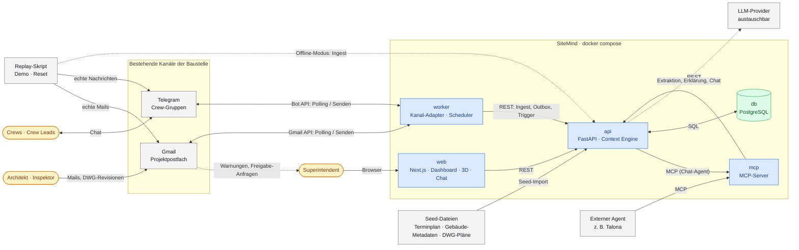
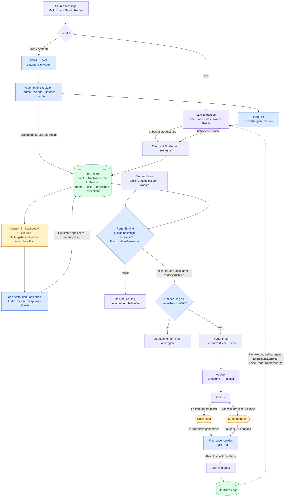
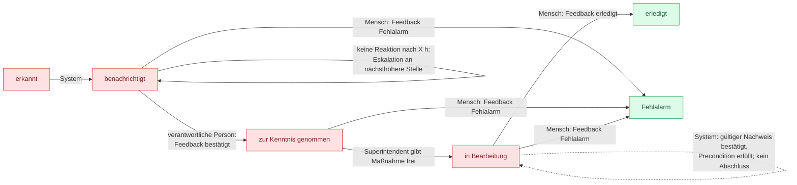

# Puntimata

## Lokal starten (Issue #2)

Voraussetzung: Docker mit Compose v2 und laufender Docker Engine (Linux-Container).
Die Basis-Images unterstützen x64 und ARM64; es wird keine Plattform erzwungen.

```sh
cp .env.example .env
docker compose up --build
```

In PowerShell statt `cp`: `Copy-Item .env.example .env`. Beim ersten Start baut auch
`docker compose up` die noch fehlenden Images; nach Codeänderungen `--build` verwenden.

- Dashboard: http://localhost:3000 – zeigt den aktuellen API- und DB-Status.
  Der Next.js-Server fragt dafür die API ab, die mit `SELECT 1` PostgreSQL prüft.
  Zum Aktualisieren die Seite neu laden.
- API-Health: http://localhost:8000/health – `200` mit
  `{"api":"ok","db":"ok"}`, bei DB-Ausfall `503` mit `db: "error"`.
- OpenAPI: http://localhost:8000/openapi.json, interaktive Dokumentation unter `/docs`.
- MCP: http://localhost:8001/mcp – startbarer Streamable-HTTP-Server ohne Tools.
- `docker compose logs worker mcp` zeigt den erfolgreichen API-Zugriff beider Dienste.
  Der Worker wiederholt die Prüfung alle 30 Sekunden; MCP prüft beim Start.

`.env.example` enthält alle derzeit benötigten Einstellungen: lokale DB-Zugangsdaten,
Host-Ports und `API_BASE_URL` (Compose-intern, standardmäßig `http://api:8000`).
Das Beispielpasswort ist ausschließlich für lokale Entwicklung. `.env` wird nicht
versioniert. Nur `api` liegt im DB-Netz und erhält DB-Zugangsdaten; die übrigen
Anwendungsdienste verwenden die REST-API.

Stoppen: `docker compose down`. Die Daten bleiben im Volume `db-data` erhalten.
`docker compose down --volumes` löscht auch die lokalen Daten.

Das Gerüst enthält ausschließlich Infrastruktur und Health-Prüfungen. Domänenmodell,
Kanal-Adapter, MCP-Tools, Authentifizierung und Hosting folgen in ihren eigenen Issues.

### Lokale Checks

Backend (Python 3.13, aus dem Repository-Ordner):

```sh
python -m venv .venv
# Aktivieren: Windows .venv\Scripts\Activate.ps1; Linux/macOS source .venv/bin/activate
python -m pip install -r backend/requirements-dev.txt
cd backend
python -m pytest tests
```

Frontend (Node.js 22, aus dem Repository-Ordner):

```sh
cd web
npm ci
npm test
npm run lint
npm run build
```

Compose-Konfiguration (aus dem Repository-Ordner):

```sh
docker compose --env-file .env.example config --quiet
```

Diese Checks laufen bei jedem Pull Request und bei Pushes auf `main` in GitHub Actions.

## Links

**Google Docs:**
https://docs.google.com/document/d/191BTonyg6-m5O6dTQWNTi6LpWj3htCbGVGOswbQmgXY/edit?usp=sharing

**Excalidraw Whiteboard:**
https://excalidraw.com/#room=ac3240648cf122511709,arFEEYfSUXenyB8QTL0RbQ

**Projektplan:** [docs/PLAN.md](docs/PLAN.md)

## Architektur

Die Diagramme hier sind die Grundlage für die Implementierung. Begriffe wie Flag, Event oder Precondition stehen in [PLAN.md §2](docs/PLAN.md). Wer die Architektur ändert, passt zuerst das Diagramm per PR an.

**Bearbeiten:** Die Quelle ist der Mermaid-Code in dieser Datei. Für das Whiteboard einen Block kopieren und in Excalidraw über *Weitere Werkzeuge → Mermaid zu Excalidraw* einfügen. Änderungen am Whiteboard danach hier im Code nachziehen.

### 1. Dienste und Kanäle



### 2. Vom Eingang zum Flag (in `api`)

Durchgezogene Pfeile sind der Hauptfluss, gestrichelte die Rückkopplung aus dem Learning Loop. LLM-Events sind Aussagen mit Prüfstatus. Sie dürfen sofort Prüfungen auslösen; als Nachweis zur Erfüllung einer Precondition zählen sie erst nach einer expliziten menschlichen Bestätigung im Dashboard. Bestätigungsstatus und Precondition-Bewertung sind getrennt (PLAN §3.2).



### 3. Flag-Lebenszyklus



### Architekturregeln

- **`api` ist der einzige Dienst mit Zugriff auf die DB.** `worker`, `mcp` und `web` sprechen ausschließlich über die REST-API (OpenAPI-Vertrag).
- **Alle Quellen laufen über einen Ingestion-Eingang.** Ein neuer Kanal (z. B. WhatsApp) ist nur ein neuer Adapter im `worker`.
- **Ausgehende Nachrichten laufen über eine Outbox.** `api` legt jede Nachricht als Eintrag an, `worker` versendet und meldet den Status zurück. Keine Nachricht geht verloren, und jede steht im Audit-Trail.
- **Das LLM berät nur** (lila im Diagramm 2). Flags entstehen ausschließlich durch die Regel-Engine, Handlungen und Abschlüsse nur durch Menschen.
- **Extraktion ist keine Nachweisbestätigung.** Nur ein zuständiger Mensch bestätigt eine LLM-extrahierte Aussage im Dashboard als Nachweis für eine konkrete Precondition. `api` prüft Status und Geltungsbereich; Quelle, Person, Zeitpunkt und Entscheidung werden protokolliert. Hohe Modellkonfidenz genügt nicht. MCP/Chat dürfen Nachweise weder bestätigen noch ablehnen oder ihren Prüfstatus übersteuern; der Rollenumschalter im MVP ersetzt keine produktionsreife Authentifizierung.
- **Fehlende oder widersprüchliche Daten sind keine Freigabe.** Preconditions werden als erfüllt / nicht erfüllt / unbekannt / widersprüchlich bewertet. Nur gültige bestätigte Nachweise erlauben „erfüllt“. Neue Gegenmeldungen gehen in die Prüfung ein, ohne menschliche Bestätigungen durch das LLM zu überschreiben. Nachweisentscheidungen lösen erneut die Regelprüfung aus; bestehende Flags bleiben bis zum menschlichen Abschluss offen.
- **Seed und CAD haben explizite Herkunft.** Synthetische bestätigte Ausgangsnachweise werden als Seed markiert; LLM-Aussagen bleiben auch im Offline-Replay unbestätigt. Deterministische CAD-Events aktualisieren Geometrie/betroffene Zonen, bestätigen aber keine Inspection, Crew-Kenntnisnahme oder Task-Abschlüsse.
- **Learning ersetzt keinen Nachweis.** Im MVP korrigiert Feedback fallbezogen die Extraktion. Es deaktiviert keine Sicherheitsprüfung und umgeht keine Bestätigungspflicht. Änderungen sicherheitsrelevanter Regeln brauchen gesonderte menschliche Freigabe, begrenzten Geltungsbereich und Audit.
- **Der Chat-Agent nutzt dieselben MCP-Tools wie externe Agents.** Was unser Chat kann, kann auch Talonas Agent.
- **Kanal-Zugangsdaten** (Gmail, Telegram) liegen nur im `worker`, der LLM-Key nur in `api`.

## DWG → DXF

LibreDWG runs as a separate optional Compose job. Setup and usage: [CAD converter](docs/CAD-CONVERTER.md). Direct DXF input remains available as fallback.
