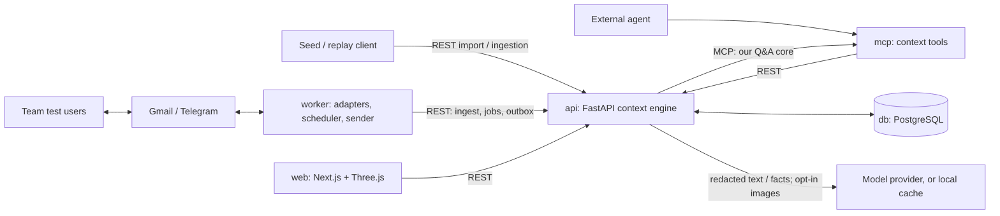
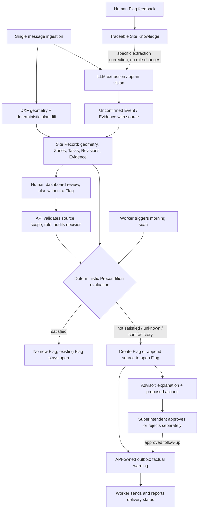
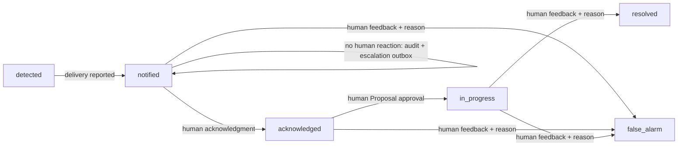

# SiteMind

**A context engine for construction sites: turn messages and plan revisions into
a shared Site Record, detect conflicts, and keep each Flag visible until a
responsible human closes it.**

Proximata Hackathon '26 · Talona track. The dashboard carries the GroundIQ visual
identity. The engine is the product; our Telegram agent and external MCP clients
use the same context tools.

This private repository and the work produced for this track belong to Talona;
the application is not MIT-licensed. See [general rules](general-rules.md) and
[COMPLIANCE.md](COMPLIANCE.md). Use synthetic data and team test accounts only.

## Run the demo

You need repository access, Git, and a running Docker Engine with Compose v2
supporting `--wait` (Linux containers; Docker Desktop on Windows).
The base images support ARM64 and x64; no platform emulation is forced.
No host Python/Node installation, LLM key, Gmail account or Telegram bot is needed
for the cached demo. The first build needs internet for images/dependencies;
after building, the offline demo needs no external services.

Clone the private repository using your authorised GitHub account:

```sh
git clone https://github.com/davidsteindl/ProximataHackathon.git
cd ProximataHackathon
```

Copy the environment template from the repository root:

```powershell
Copy-Item .env.example .env
```

On Linux/macOS use `cp .env.example .env`. The defaults select cached extraction,
advice, Q&A routing and vision; both external message adapters are disabled.
The sample database password is public and for local development only.
If another stack is already running, choose a distinct `COMPOSE_PROJECT_NAME`
and host ports in `.env` before starting; update `DASHBOARD_BASE_URL` accordingly.

Start all five services, then stop the normal worker while using the simulated
demo clock. The replay command will run its own worker client:

```sh
docker compose up --build -d --wait
docker compose stop worker
docker compose run --rm --no-deps -v ./cad:/cad:ro -v ./.replay:/replay-output worker python -m app.replay --reset-only --output /replay-output/reset.jsonl
```

**Reset replaces all demo data**, including sources, Evidence review history,
Flags, Proposals, outbox, learning and geometry. On a fresh instance it imports
the synthetic building, schedule, Crews, Evidence baseline and four Rev-C DXF
plans. Rev D arrives later in the hero replay. Transcripts remain in local
`.replay/`, which Git ignores. Do not use reset on an instance with data to keep.

| Open with default ports | Expected result after reset |
| --- | --- |
| [Dashboard](http://localhost:3000) | Building overview, upcoming Tasks and activity |
| [3D site](http://localhost:3000/site) / [bathroom 3B](http://localhost:3000/zones/3B-BATH) | Geometry from imported plans; selectable floors and Zones |
| [Evidence review](http://localhost:3000/evidence) | Explicit synthetic baseline and unconfirmed/contradictory sample claims |
| [Flag inbox](http://localhost:3000/flags) / [Proposals](http://localhost:3000/proposals) | Human workflow views; the replay creates new conflicts |
| [API health](http://localhost:8000/health) | HTTP 200, `{"api":"ok","db":"ok"}` |
| [API docs](http://localhost:8000/docs) / [OpenAPI](http://localhost:8000/openapi.json) | REST contract |
| MCP: `http://localhost:8001/mcp` | Streamable HTTP endpoint for an MCP client, not a browser page |

### Guided hero scenario

Keep the normal worker stopped and run this in an interactive terminal:

```sh
docker compose run --rm --no-deps -v ./cad:/cad:ro -v ./.replay:/replay-output worker python -m app.replay --mode offline --speed 3600 --output /replay-output/hero.jsonl
```

This resets the baseline again and advances the synthetic scenario clock.
Follow the terminal's dashboard links and perform each requested human action,
then press Enter. Enter checks the stored decision; it makes no decision itself.

1. The architect's Rev-D DXF moves bathroom 3B's wall by 30 cm. The deterministic
   plan diff identifies 3B; **Flag B** reports missing valid Crew receipt of Rev D.
2. A postponed Inspection and “Abnahme dürfte passen” remain unconfirmed.
   “morgen früh machen wir 3B zu, platten sind da” triggers **Flag A** because
   the required Inspection is not established.
3. Acknowledge the Flag and separately approve the Superintendent's Proposal.
   Closing the Flag with feedback does not confirm an Inspection.
4. Correct a question misread as a work announcement using explicit false-alarm
   feedback. Repeating that exact case uses traceable Site Knowledge; a genuine
   unsafe work announcement still creates a Flag.
5. Review the specific day-4 Inspection Evidence and resolve the sample
   counterclaim separately. A satisfied Precondition still leaves its Flag open
   for a separate human closure.

Offline deliveries are explicitly recorded as synthetic in the transcript and
outbox; no email or Telegram message is sent. Offline questions show record
context, not simulated Telegram answers. Real channel delivery and Telegram Q&A
need the optional test-account setup below. Replay does not automatically verify
answer contents (`telegram_answers_verified: false`).
Full sequence, checkpoints and online mode: [REPLAY.md](docs/REPLAY.md).

For a single work-announcement example after reset, use this one-line command
(PowerShell: `curl.exe` instead of `curl`):

```sh
curl http://localhost:8000/ingestion/messages -H "Content-Type: application/json" --data-binary "@backend/demo/closing-work.json"
```

The response contains source-backed Events; the Flag inbox shows the deterministic
conflict. Repeating the same source does not duplicate its Events. With the
normal worker stopped, notifications stay queued. Use the full replay above
for a fresh scenario with explicitly synthetic delivery.

### Stop, restart and troubleshoot

`docker compose down` stops the stack and preserves the database volume.
`docker compose up -d` starts it again; `--build` rebuilds changed code.
`docker compose down --volumes` also deletes this stack's database. It does not
delete provider copies, local OAuth files or replay transcripts.

- Startup failure: use `docker compose ps` and `docker compose logs --tail 100 api worker mcp web`.
  API startup applies Alembic migrations before serving; DB failure returns health
  HTTP 503. Wait for a healthy API before resetting.
- Empty site/3D: run reset-only above. A plain seed import clears geometry;
  `docker compose exec api python -m app.cad_import` imports **all five** bundled
  plans, including Rev D. For the hero's Rev-C starting point use reset-only.
- `cache_miss`: cached mode recognises the authored demo text/role (and photo
  bytes), not arbitrary messages. Use the exact fixtures/replay or configure a
  live provider explicitly. There is no live fallback.
- No real notification: adapters are off by default. Seed Crew Leads have no
  email addresses; configure team recipients and the appropriate transport.
  Pending/failed deliveries and safe error codes are visible in the Flag/outbox.
- Unexpected early Flags: the normal worker uses the real clock for scans and
  escalation. Keep it stopped during replay; replay invokes jobs itself.
- Port collision or multiple worktrees: give each `.env` a distinct
  `COMPOSE_PROJECT_NAME`, `API_PORT`, `MCP_PORT` and `WEB_PORT`. Update
  `DASHBOARD_BASE_URL` to match the browser-facing web port.
  Keep `API_BASE_URL=http://api:8000` and `MCP_URL=http://mcp:8001/mcp`
  for Compose-internal traffic. Project names also separate database volumes.
- API/MCP have no production authentication and published ports bind all host
  interfaces by default. Use a trusted local network/firewall; do not expose the
  demo publicly.

## Environment and optional integrations

[.env.example](.env.example) documents every Compose input and its defaults.
`.env` and `.gmail/` are ignored; never commit credentials. Recreate affected
services after edits with `docker compose up -d api worker mcp web`.

| Configuration | Owner and use |
| --- | --- |
| `COMPOSE_PROJECT_NAME`, host ports | Compose stack/volume isolation and browser access |
| `POSTGRES_*` | Local database; Compose maps these to `PG*` only inside API |
| `API_BASE_URL`, `MCP_URL` | REST consumers and API's own MCP client |
| `LLM_*` | API extraction/advisor; `cached` or `openai_compatible` |
| `VISION_*` | API photo findings; cached by default, live uses `LLM_BASE_URL` / `LLM_API_KEY` |
| `QA_ROUTER_PROVIDER`, `OPENAI_API_KEY`, `QA_CONFIDENCE_THRESHOLD` | API Q&A routing; cached by default, `decisions` explicitly enables live routing |
| `GMAIL_*` | Worker-only, opt-in inbound/read and outbound/send; OAuth under `.gmail/` |
| Telegram bot, allowlists, sender role/Crew maps, poll interval, photo opt-in | Worker-only transport configuration |
| `TELEGRAM_COMPLIANCE_KEY` | Shared API/worker credential for privacy, retention and Telegram Q&A routes |
| Telegram retention/operator, Crew Lead/group recipient maps | API privacy policy and outbox addressing |
| `MORNING_SCAN_TIME`, `ESCALATION_CHECK_SECONDS` | Worker schedule, in Site local time / elapsed seconds |
| `SCAN_LOOKAHEAD_DAYS`, `ESCALATION_HOURS`, `SUPERINTENDENT_EMAIL`, `DASHBOARD_BASE_URL` | API scan/escalation policy, test recipient and browser links |

Gmail and Telegram credentials live only in `worker`; LLM keys only in `api`.
No model or channel credentials are passed to web, MCP or external agents.
`SUPERINTENDENT_EMAIL` and recipient maps are contact configuration, not credentials.

- **Gmail:** [GMAIL.md](docs/GMAIL.md) gives Cloud/OAuth setup and exact
  `gmail.readonly` + optional `gmail.send` scopes. Use a dedicated project test
  mailbox, never a personal mailbox. Optional host OAuth setup needs Python 3.13
  and the backend requirements. External/Testing refresh tokens expire after 7
  days. Enable inbound and outbound separately and configure team recipients.
- **Telegram:** [TELEGRAM.md](docs/TELEGRAM.md) covers BotFather, privacy mode,
  numeric chat **and** user allowlists, mapped roles/Crews, privacy commands and
  Q&A. Empty allowlists deny all. Use a random local shared worker key and actual
  test operator contact. Photos require explicit `TELEGRAM_PHOTOS_ENABLED=true`;
  image pixels are not anonymised: [photo limits](docs/COMPLIANCE.md).
- **Live models:** extraction/advisor need `LLM_PROVIDER=openai_compatible`,
  `LLM_BASE_URL` ending in `/v1`, `LLM_MODEL` and `LLM_API_KEY` for a
  JSON-mode-capable provider. Vision uses a vision-capable `VISION_MODEL` or
  falls back to `LLM_MODEL`. Q&A `decisions` uses its own key and fixed endpoint.
  EU processing, DPA and zero retention are deployment requirements, not defaults;
  read [COMPLIANCE.md](COMPLIANCE.md) before enabling live processing.
- **Normal operation:** after reset and adapter configuration,
  `docker compose up -d worker` resumes polling, advice generation, outbox
  delivery and scheduled jobs. `MORNING_SCAN_TIME=off` and
  `ESCALATION_CHECK_SECONDS=0` disable automatic jobs, not inbound polling.
  Default scan is 06:00 Site time, one day ahead; escalation is after four hours
  without human reaction. Both jobs can be triggered with a simulated `as_of`:
  [FLAGS.md](docs/FLAGS.md#morning-scan-and-escalation-14).

### MCP connection

An MCP client uses **Streamable HTTP** at `http://localhost:8001/mcp`
(adapt `MCP_PORT`). Internal clients use `http://mcp:8001/mcp`.
No DB, LLM or channel credentials belong in the client. An optional inspector
is available via `npx @modelcontextprotocol/inspector` (requires Node.js).

| Tool | Purpose |
| --- | --- |
| `list_zones` | Discover Site and Zone hierarchy |
| `get_zone_status(zone_id)` | Preconditions, Evidence review status, Tasks, Flags, plans and sources |
| `list_flags(status="open")`, `get_flag(flag_id)` | Flag context and audit |
| `get_timeline(zone_id?, from_time?, to_time?, limit=100)` | Source-backed changes and current Evidence snapshot |
| `search_record(query, zone_id?, limit=50)` | Literal search in the Site Record |
| `get_zone_plan(zone_id, revision_id?)` | Imported geometry in metres |
| `get_plan_diff(revision_id)` | Deterministic comparison to the preceding Revision |
| `create_proposal(flag_id, action, rationale)` | Store a proposed action without approving/executing it |

Try `get_zone_status` with `{"zone_id":"3B"}`. Outputs provide JSON
`structuredContent`, source references and uncertainty. A missing evaluation is
`unknown`, never clearance. Limits are at most 200; truncation is explicit.
Time filters require a UTC offset and use `[from_time, to_time)`.
`source:<id>`, `event:<id>`, `evidence:<id>` and other record references
resolve through the REST contract. Original CAD source downloads include hashes.

Our Telegram Q&A core uses these same tools through `MCP_URL`. The model routes
question type and Zone; answers are built deterministically from the record,
with citations and review status. Decision requests go to the Superintendent;
Evidence confirmation requests direct the human to the dashboard. There is no
dashboard chat. See [Telegram Q&A](docs/TELEGRAM.md#questions-and-superintendent-decisions-20).

## Architektur

The glossary and autonomy contract are in [PLAN §2–3](docs/PLAN.md).
The diagrams below describe the implemented service boundaries. Mermaid source
lives here; update it with architecture changes.

### Services and channels



### Ingestion, Evidence and rules



### Flag lifecycle



The core rules are:

- Only `api` touches the database; worker, MCP and web use REST/OpenAPI.
  Inbound channel messages share one ingestion path. All application notifications
  use the outbox; delivery can repeat after an ambiguous provider response.
- The LLM advises. Deterministic rules alone create Flags; humans alone close
  them with feedback/reason. All Flag transitions are audited with actor, time,
  channel and source. Factual notifications/escalation are automatic; operative
  instructions require human Proposal approval.
- Extracted Events, including high-confidence statements, are unconfirmed.
  In `/evidence`, a responsible human inspects the source and exact scope
  (Zone, Inspection/Task or Crew + Revision), then confirms/rejects Evidence.
  API records reviewer, time, source and decision and re-runs rules, including
  when there is no existing Flag.
- Preconditions are `satisfied`, `not_satisfied`, `unknown` or `contradictory`.
  Missing, stale, mismatched, unconfirmed or unresolved contradictory Evidence
  cannot satisfy them. New counterclaims remain visible; models cannot overwrite
  human decisions. Explanations distinguish uncertainty from confirmed failure.
- Evidence review, Flag acknowledgment, Proposal approval and Flag closure are
  independent actions. Confirming Evidence closes nothing; acknowledging/closing
  a Flag or approving a Proposal confirms no Evidence.
- Synthetic baseline Evidence is explicitly labelled `seed_baseline` with seed
  provenance, not fabricated human confirmation. Offline/replayed LLM claims stay
  unconfirmed. CAD events establish geometry/affected Zones, never an Inspection,
  Crew receipt or Task completion.
- MCP/chat cannot review Evidence, approve Proposals or close Flags. API blocks
  mutations marked `mcp|chat|agent` except storing an agent Proposal. This header
  convention and the dashboard role switcher are **not authentication**.
- Learning corrects a specific extraction error through traceable feedback; it
  cannot auto-confirm Evidence, disable checks or suppress genuine conflicts.
  Safety-rule changes require separate human approval, narrow scope and audit.

## Scope and assumptions

The implemented conflict checks cover **A:** closing work before a confirmed
Inspection; **B:** work without confirmed receipt of the current plan Revision;
and **C:** work before confirmed predecessor Task completion. Scans and Event
checks share the Evidence policy. Flags belong to Zones, Tasks and trades,
with responsible Crew Leads and Superintendent decisions; there are no per-person
performance rankings.

The synthetic Site has one building, four floors and four apartments per floor.
Its scenario dates and Europe/Vienna clock are fixed; replay simulates time
instead of shifting records to today. The 3D building comes from the API's DXF
geometry; decorative cranes/scaffolding are labelled context. DXF input must
follow the [layer/Zone convention](cad/README.md). Plan diff uses stable element
IDs; notes provide an explicitly unconfirmed fallback when geometry diff fails.

This is not a production authorisation, worker-monitoring or safety-certification
system. Authentication/permissions, comprehensive retention, real third-party
data, automatic safety-rule learning, DWG import/export integration and production
hosting are outside the MVP. LibreDWG is an optional **separate process** prototype,
not a linked library: [CAD converter](docs/CAD-CONVERTER.md).
Photo findings remain advisory and need the same human Evidence review.

## Verification with GitHub CI

[The CI workflow](.github/workflows/ci.yml) runs on every pull request and pushes
to `main`. It uses the same repository suites/commands that can be run locally:

| Job | Environment and commands |
| --- | --- |
| Backend | Python 3.13; install `backend/requirements-dev.txt`; `python -m pytest backend/tests` with `PYTHONPATH=backend` |
| Frontend | Node.js 22 in `web/`; `npm ci`, `npm test`, `npm run lint`, `npm run build` |
| Compose | `docker compose --env-file .env.example config --quiet` |

Provider HTTP calls are mocked; CI needs no LLM/Gmail/Telegram credentials.
Backend suites use isolated test databases; Compose CI validates configuration,
it does not boot a full stack. Green CI is not evidence of live account delivery,
ARM64 runtime verification or production compliance. Review a PR's Checks tab
for its exact commit.

## Further documentation

- [Project plan, glossary and hero acceptance scenario](docs/PLAN.md)
- [Site Record, seed and Evidence contract](docs/SITE_RECORD.md)
- [Ingestion and extraction](docs/INGESTION.md)
- [Flags, evidence evaluation, scans and escalation](docs/FLAGS.md)
- [Proposals, blocked Tasks and human approval](docs/PROPOSALS.md)
- [CAD extraction and plan diff](docs/CAD-PIPELINE.md)
- [Learning and feedback metric](docs/LEARNING.md)
- [Replay and reset](docs/REPLAY.md)
- [Compliance and production gaps](COMPLIANCE.md)
- [Dashboard design handoff](design/HANDOFF.md)
