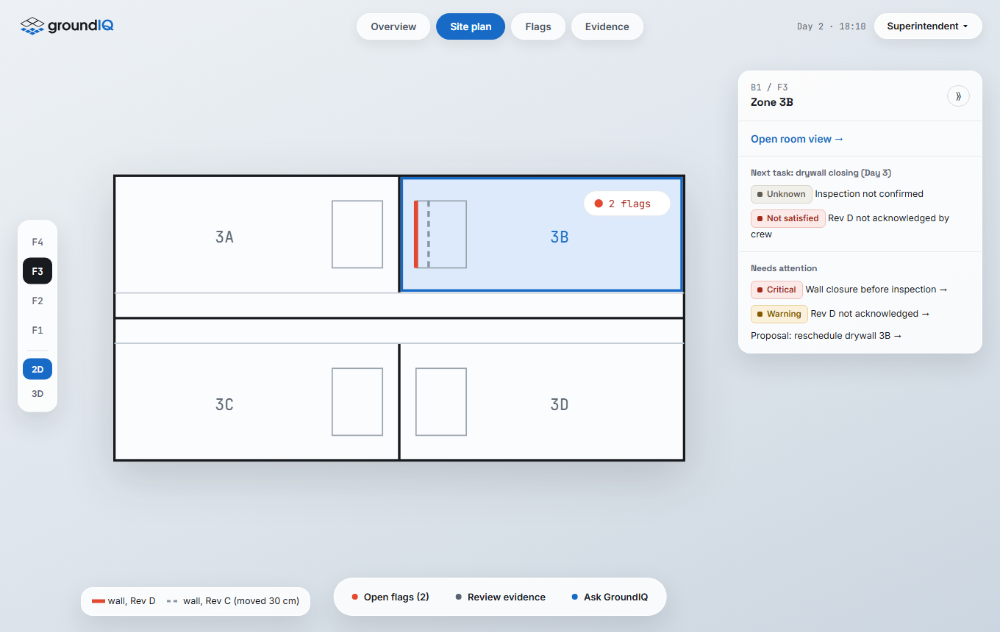
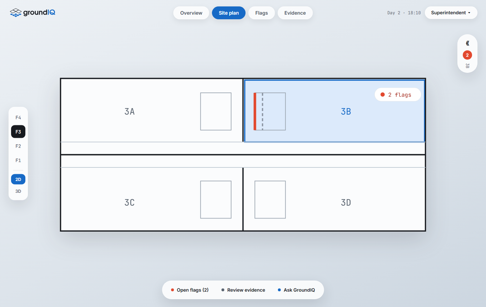

# Dashboard mockup handoff (issue #35)

The mockup lives in `design/mockup/`. Open `design/mockup/index.html` in any
browser. Pages use static HTML with inline CSS and SVG plus local demo interaction JavaScript. Nothing needs to
be built or served, and only Google Fonts loads from the network. All data is
synthetic and comes from the hero scenario in `docs/PLAN.md` §7.

Live canvas with all pages side by side:
https://claude.ai/artifact/3MjWimC7hjDSDSK9RqtxxN

The `*.dc.html` files come from the Claude design canvas. `support.js` is an
empty stub for its runtime, and `canvas.json` holds the board layout. Both can
be ignored when implementing.

| Widget expanded, zone 3B selected | Widget collapsed |
|---|---|
|  |  |

Start page: `mockup/screenshots/Main.png`.

## Pages and navigation

| Page | Theme | Purpose | Implementation issue |
|---|---|---|---|
| `Main` | dark | Superintendent start: KPI row, site model with markers, "Needs your attention", activity, next 48 h | #5, #37 |
| `SiteOverview` | light | Plan with no zone selected, widget expanded | #16 |
| `SiteZone3B` | light | Zone 3B selected; widget shows preconditions and attention items | #16 |
| `SiteCollapsedNone` | light | Widget collapsed with no selected Zone; reopen returns to Site context | #16 |
| `SiteCollapsed` | light | Widget collapsed to a pill (count + zone). Selection kept, reopen with `⟪` | #16 |
| `Site3D` | light | Isometric 3D placeholder with floor rail and markers | #16, #17 |
| `RoomView` | light | `/zones/3B`: room plan with the Rev D wall diff, status, tasks, inspections | #15, #17 |
| `FlagInbox` | dark | Stat tiles and flag table | #9 |
| `CrewLead` | dark | Crew Lead warning with original sources and acknowledgment only | #9 |
| `FlagDetail` | dark | Lifecycle, precondition explanation, source quotes, timeline, acknowledge and close | #7, #8, #9 |
| `EvidenceReview` | dark | Confirm or reject evidence. Works without a flag | #6, #30 |
| `ProposalDetail` | dark | Approve or reject an advisory LLM proposal | #13 |
| `SystemStates` | dark | Loading, empty and error states; Gmail and Telegram deep links into the dashboard | #10, #12 |

Navigation: dark pages use the left sidebar, light plan pages use the top pill
nav plus a bottom quick-action dock. Both link to the Crew Lead demo view; that view links back to the Superintendent. These explicit role-view links are a demo mechanism, not authentication.
"Ask GroundIQ" and "Chat" point to `#chat` as a placeholder for #19.

## Human actions stay separate

Each decision gets its own control and its own page:

- **Evidence**: Confirm / Reject in `EvidenceReview` only. This does not close any flag, and MCP or chat cannot do it.
- **Flag acknowledge**: a separate card in `FlagDetail`.
- **Proposal**: Approve / Reject in `ProposalDetail`, labelled "LLM proposal — advisory".
- **Flag closure**: in `FlagDetail`, Resolved or False alarm plus a required reason. Superintendent only. The system never closes flags.

Precondition results use four chips: Satisfied (green), Not satisfied (red),
Unknown (grey) and Contradictory (violet). Unconfirmed evidence shows its
confidence with the note "confidence is not confirmation".

## Visual tokens

Brand: GroundIQ. The logo is `mockup/groundiq-logo.svg`. On dark backgrounds use
`groundiq-logo-white.svg`, which swaps black for `#F2F4F7` and keeps the blue.

| Token | Value |
|---|---|
| Brand blue (only accent) | `#176AC6`; text on dark `#5AA2EE` |
| Cool black | `#171A1F` (panels, ink), `#0E1116` (dark page bg), `#12151B` (sidebar) |
| Dark borders / muted | `#262B33` / `#8A93A1` |
| Light page bg | `linear-gradient(155deg,#EDF1F5,#DDE4EB 55%,#CCD6E0)` |
| Glass card | `rgba(255,255,255,.85)`, radius 16, shadow `0 14px 36px rgba(23,26,31,.12)` |
| Critical / warning / ok | `#FF7A66` / `#E8B04B` / `#43CD8A` on dark; `#A3271A` / `#845800` / `#1E6F42` on light |
| Plan: selected zone | fill `#DCEAFB`, stroke `#176AC6` |
| Plan: changed wall (Rev D) | `#E2492F`; old position dashed `#8A93A1` |

Type: Space Grotesk for headings, Inter for body text (14 px), JetBrains Mono
for timestamps, IDs and plan labels. Spacing follows a loose 4 px grid. Panels
are 14–16 px radius, and pills and buttons are fully rounded.

## Synthetic fixtures used

- Site B1, floor F3, zones 3A–3D; hero zone 3B with plan A-103, Rev C → Rev D (bathroom wall moved 30 cm, drain rerouted).
- FLG-0007 critical: drywall closing 3B on Day 3 before the rough-in inspection is confirmed (conflict A).
- Warning flag: Rev D not acknowledged by the drywall crew (conflict B).
- Evidence: an unconfirmed claim "Abnahme dürfte passen" (confidence 0.93), one contradictory claim for 2C, and one confirmed seed record.
- Clock: Day 2 · 18:10.

## Open decisions

1. Three.js scope (#16): the 3D view is a static isometric SVG. Floor isolation and camera controls are still to be decided.
2. Is the dark/light split (dark work views, light plan views) kept in the real app, or should it be one theme with a toggle?
3. Chat placement (#19): a drawer from the dock/sidebar or a separate page.
4. Production role permissions need agreement in #9/#30. The mockup demonstrates Superintendent decisions and a Crew Lead who reads sources and acknowledges their warning; it does not define authorization or new API permissions.
5. Accessibility: tab order and labels are in place, but colour contrast on glass cards over the plan still needs a check in the real build.

## Local decision walkthrough

Open the hero Flag, then Evidence review to use the Day 4 positive-result fixture. Confirming or rejecting changes only that Evidence. Return to the Flag: a confirmed inspection is shown as satisfied while the Flag stays open. Proposal approval/rejection, acknowledgment and closure are independent local actions. Closure requires Resolved/False alarm plus a non-empty reason. The timeline records synthetic demo decisions. Reset walkthrough on the Flag clears them.

State is kept in browser session storage for navigation between local pages; if storage is unavailable, changes apply only to the current page and a notice explains this. No API requests, real schedule changes or notifications occur. Production actions and validation remain in #9, #13 and #30; this defines no new API contract.

Collapse/reopen preserves context through separate linked fixtures: `SiteOverview` -> `SiteCollapsedNone` -> `SiteOverview` has no selected Zone; `SiteZone3B` -> `SiteCollapsed` -> `SiteZone3B` retains 3B.

## Demo role actions

| View | Demonstrated actions |
|---|---|
| Superintendent | Confirm/reject the inspection claim, approve/reject the proposal, acknowledge and close the Flag with feedback |
| Crew Lead | Read their warning, original quotes and timeline; acknowledge the warning only |

The Crew Lead fixture has no Evidence review, Proposal decision or Flag closure controls. Links explicitly switch the demo role. Production permissions remain an implementation question, not an authentication claim.
